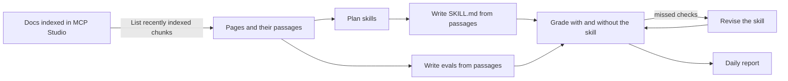

# docs-to-self-evaluating-skills

Turn documentation you trust into agent skills your AI coding assistant can follow, and have each skill graded against that documentation and improved every day.

Say you are adding Amazon S3 uploads to a web app. Index the S3 docs in [MCP Studio](https://appatools.com/mcp-studio), point this project at that source, and you get skills such as `s3-presigned-uploads`: a `SKILL.md` that Cursor, Claude Code, or Codex follows to set it up in your codebase, built from the exact passages in the docs. Each skill ships with evals written from the same passages, a score with and without the skill, and a daily report of what improved.

It is a sample project for the MCP Studio API. Everything it reads comes from one endpoint, [List recently indexed chunks](https://docs.appatools.com/api/reference/sources), and its grading is the same evidence-checked grading as the [MCP Studio eval playground](https://appatools.com/eval-playground).

## How it works



Every day, after MCP Studio refreshes your sources:

1. **Sync.** Reads every chunk of each configured source and compares page fingerprints with yesterday's. A source that is still indexing is skipped until tomorrow.
2. **Plan.** On the first run, a model reads the page titles and proposes up to 25 task-shaped skills per source, each tied to the pages it needs. The plan is saved in `state/plan.json`; edit it by hand if you like.
3. **Build.** A new skill, or one whose pages changed, is written from those pages' passages. Its evals are rewritten from the same passages, so the skill is graded against the docs rather than against itself.
4. **Grade.** Each eval is answered twice, once following the skill and once without it, and every check is graded. A pass counts only when the grader quotes the answer, so a lenient grader cannot pass a check it did not verify.
5. **Improve.** The model revises the skill using the checks it missed, and the revision is graded again. It replaces the skill only if it passes at least two more checks **and** no fewer held-out checks. Half the evals are held out and never shown to the reviser, so a skill cannot be rewritten to pass only the tests it saw. [How a skill improves itself](#how-a-skill-improves-itself) explains this step in full.
6. **Report.** Writes `reports/YYYY-MM-DD.md`: what changed in each source, every skill's score with and without it, the change since yesterday, the checks a revision fixed, and pages no skill covers yet.

## Quickstart

You need Node 20 or later, an MCP Studio account, and an OpenAI API key.

1. **Get the code.** Click **Use this template** on GitHub to make your own copy (the daily workflow commits to it), then clone it:

   ```bash
   git clone https://github.com/<you>/<your-copy>.git
   cd <your-copy>
   ```

2. **Index your docs.** In [MCP Studio](https://appatools.com/mcp-studio), create a server and add the documentation as a source. Wait until the source shows as indexed.
3. **Create an API key** in [**Account** > **API Keys**](https://appatools.com/mcp-studio/account/api-keys). It starts with `msk_live_` and is shown once.
4. **Find the source ID.** Your server slug is the last part of its MCP URL (`https://appatools.com/mcp-studio/api/mcp/<your-server-slug>`).

   ```bash
   export MCP_STUDIO_API_KEY=msk_live_...
   curl https://appatools.com/mcp-studio/api/mcp/<your-server-slug> \
     -H "Authorization: Bearer $MCP_STUDIO_API_KEY" | jq '.sources[] | {id, url}'
   ```

5. **Configure.** Put the server slug and source ID in `skills.config.json`. Then create `.env` and fill in `MCP_STUDIO_API_KEY` and `OPENAI_API_KEY`:

   ```bash
   cp .env.example .env
   ```

6. **Run.** No `npm install` is needed; the project has no dependencies.

   ```bash
   npm test
   npm run daily
   ```

   The first run plans and builds the skills. Expect about 40 seconds and a few dozen model calls per skill, so a source that fills all 25 takes roughly 15 to 20 minutes, and later days are faster.

## Run it every day on GitHub Actions

`.github/workflows/daily.yml` runs at 15:00 UTC, two hours after MCP Studio refreshes sources, and commits `skills/`, `state/`, and `reports/` back to the repository. The run summary on the Actions page is that day's report.

1. Commit your `skills.config.json` and push it to your copy. Never commit `.env`; it is gitignored.
2. If your copy is a fork, open the **Actions** tab and enable workflows, since GitHub turns off scheduled workflows on forks.
3. Add `MCP_STUDIO_API_KEY` and `OPENAI_API_KEY` under **Settings** > **Secrets and variables** > **Actions**. Optionally add a variable named `OPENAI_MODEL`.
4. Run the workflow once from the **Actions** tab, or wait for the schedule. Tick **replan** to plan the skills again from scratch.

## How a skill improves itself

A skill gets better the same way a person's notes do: someone checks whether following it produces the right result, finds what was missed, and fixes the instructions. Here a model does the fixing, and the checks decide whether the fix stays.

**The checks are fixed and come from the docs.** When a skill is first written, the project also writes its evals from the same documentation passages: a few requests a developer would make, and for each one, three checks naming exact things a correct answer must contain, such as a command, a parameter, a permission, or a limit. The evals stay the same from day to day, so scores are comparable. They are rewritten only when the skill's documentation pages change.

**Half the evals are held out.** Evals alternate between *practice* and *held out*. The model that revises the skill sees only the practice misses. The held-out evals are graded every time but never shown to it, which is how the project notices a revision that learned the test instead of the task.

**Each day, for each skill:**

1. **Grade the skill as it is.** Every eval is answered by a model following the skill, and every check is graded. A check passes only when the grader quotes the part of the answer that satisfies it.
2. **Collect what it missed.** For each practice eval with a failed check, the reviser gets the request, the checks that failed, and the start of the answer.
3. **Revise.** The reviser gets the current skill, those misses, and the documentation passages, and rewrites the skill. It is told to use only facts from the passages and never to mention the tests, so it fixes the instructions rather than writing in answers.
4. **Grade the revision** on every eval, practice and held out.
5. **Keep it or throw it away.** The revision replaces the skill only if it passes at least `minGain` more checks (2 by default) **and** passes no fewer held-out checks. Otherwise the current skill stays, the report lists it under *Revisions not kept*, and that skill stops for the day.
6. **Go again** if the revision was kept and checks are still failing, up to `improveRounds` times (2 by default).

The next day starts by grading the skill again, so each day's improvement is measured against a fresh score rather than yesterday's.

**When the docs change,** the skill and its evals are rewritten from the new text, and improvement starts over. Revisions made against the old docs could teach steps the docs no longer describe.

**What it cannot do:** it cannot add anything the documentation does not say, it does not run the code in an answer, and one graded run varies by a check or two, which is why a revision has to win by `minGain` before it is kept.

## Find each day's eval report

Nothing is emailed or posted anywhere. Each run writes its report into the repository, and the GitHub workflow commits it, so every day's report stays in your history.

**On GitHub**

1. Open your copy of the repository and go to the `reports` folder.
2. Open the file named with the run's date, such as `2026-10-23.md`. GitHub renders it as a page.

Or open the **Actions** tab, choose **Daily skills run**, and open a run. The report is shown as that run's summary, and a failed run shows the error.

**Locally**, after `npm run daily`, the report is at `reports/<today's date>.md`, and the same report is printed at the end of the run.

**What the report contains:**

- **Sources:** how many chunks and pages each source has, and how many pages were added, changed, or removed since the last run. A source MCP Studio is still indexing is listed as skipped.
- **Skills:** one row per skill: whether it is new, rebuilt because its docs changed, improved, or unchanged; its score with the skill and without it; and the change since the last run.
- **What improved:** the exact checks a kept revision now passes.
- **Revisions not kept:** skills whose revision did not win by enough.
- **Pages not in any skill:** documentation no skill covers yet.

[`examples/mcp-studio-sdk-docs/reports/`](examples/mcp-studio-sdk-docs/reports/) has two real reports.

**To dig into one skill:**

| What | Where |
|---|---|
| The latest answers and every check's grade and quote | `skills/<name>/evals/latest.json` |
| The evals, and the score without the skill | `skills/<name>/evals/evals.json` |
| What a revision changed | The diff of `skills/<name>/SKILL.md` in that day's commit |
| Every skill's score, every day | `state/history.jsonl`, one line per skill per run |

To get the report somewhere else, add a step to `.github/workflows/daily.yml` after the run that sends `reports/$(date -u +%F).md` to Slack, email, or an issue.

## Use the skills

Each skill is a folder in `skills/` containing `SKILL.md`. Copy the folders you want into your assistant's skills directory, such as `.cursor/skills/` or `.claude/skills/`, in the project where you are building. The `## Sources` list at the bottom of each skill links the pages it was written from.

`skills/<name>/evals/evals.json` holds the evals and the score without the skill. `skills/<name>/evals/latest.json` holds the latest answers and grades, if you want to see why a check failed.

## Configuration

`skills.config.json`. Copy this, then replace the server slug and source IDs with yours. Add one entry to `sources` per source you want skills from:

```json
{
  "sources": [
    { "server": "aws-docs-a1b2c3", "sourceId": "cm1src000002" },
    { "server": "aws-docs-a1b2c3", "sourceId": "cm1src000003" }
  ],
  "maxSkillsPerSource": 25,
  "evalsPerSkill": 4,
  "improveRounds": 2,
  "minGain": 2,
  "maxPassageChars": 40000
}
```

Every field except `sources` is optional and falls back to the default below.

| Field | Default | Meaning |
|---|---|---|
| `sources` | | `[{ "server": "<slug or id>", "sourceId": "<id>" }]` |
| `maxSkillsPerSource` | 25 | Skills planned per source |
| `granularity` | `topic` | `topic` plans task-sized skills from groups of pages. `chunk` writes one skill per indexed chunk and skips chunks whose text another chunk already holds |
| `concurrency` | 1 | Skills built at the same time. Use 4 to 8 with `chunk`, which makes hundreds of skills |
| `includeUrlPrefixes` | none | Only use pages whose URL starts with one of these, for example `["https://docs.example.com/"]` |
| `evalsPerSkill` | 4 | Evals per skill, half held out |
| `improveRounds` | 2 | Revision attempts per skill per day |
| `minGain` | 2 | Extra checks a revision must pass to be kept |
| `maxPassageChars` | 40000 | Documentation text given to the model per skill |

`.env`. Copy this into a file named `.env` in the project folder and fill in your keys. It is gitignored, so it never reaches your repository:

```bash
# Required: an MCP Studio API key from Account > API Keys
MCP_STUDIO_API_KEY=msk_live_your_key_here

# Required: an OpenAI API key
OPENAI_API_KEY=sk-your_key_here

# Optional: the model that writes, answers, and grades (default gpt-4o-mini)
OPENAI_MODEL=gpt-4o-mini

# Optional: only if you are not using https://appatools.com/mcp-studio
# MCP_STUDIO_BASE_URL=https://appatools.com/mcp-studio
```

On GitHub Actions, set the two keys as repository secrets instead, and `OPENAI_MODEL` as a repository variable if you want a different model. See [Run it every day on GitHub Actions](#run-it-every-day-on-github-actions).

### One skill per chunk

Set `"granularity": "chunk"` and every chunk MCP Studio holds for a source becomes its own skill, graded against that chunk. There is no planner step. A source with 300 chunks makes about 250 skills (exact duplicates are skipped) and roughly 35 model calls each, so set `concurrency` and expect the first run to take a while. An agent cannot read hundreds of skills at once: it should see each skill's name and description and open only the ones that fit.

Chunk skills are linked so an agent can keep walking through the docs:

- Each skill ends with a **Related skills** section: the chunk before and after it on its page, the start of its page, and the skills for pages its text links to. The links are written by code, so every one points at a skill that exists, and they are refreshed on every run.
- A **map skill** per source (`docs-map-<source>`) lists every page with the skills written from it. It is the place to start when you do not know which skill fits.

Linking helps an agent find a neighboring chunk, not read it for it. If the docs themselves say something different from the rest of the page, the skills will too.

## Example

`examples/mcp-studio-sdk-docs/` is two consecutive days run against the MCP Studio SDK docs with two skills: the skills, their evals, and both reports. It was run before `minGain` was raised to 2, so its second day kept a one-check revision that the current default would not.

On the first day the Codex skill passed 8 of 12 checks against 1 of 12 without it, and the Claude skill passed 11 of 12 against 0.

## What the score means, and what it does not

- The score is the share of checks, written from the documentation, that an answer following the skill passes. The baseline is the same model answering without the skill.
- Answers are graded as text. Nothing is executed, so a passing answer has the right steps and identifiers, not necessarily code that runs.
- One graded run per day varies by a check or two even when nothing changed. Read a small move as noise; that is why `minGain` defaults to 2.
- When a skill's pages change, the skill and its evals are rewritten from the new text, so earlier revisions to that skill are replaced.
- Very large sources show only the first 400 page titles to the planner. Split the source, or edit `state/plan.json`, if the skills you want are beyond that.

## Files

```
skills.config.json      which sources to read, and limits
src/mcp-studio.mjs      the chunks endpoint client
src/pages.mjs           pages, fingerprints, and what changed
src/plan.mjs            planning skills from page titles
src/skills.mjs          writing and revising SKILL.md
src/evals.mjs           writing, running, and scoring evals
src/eval-core.mjs       evidence-checked grading from the MCP Studio eval playground
src/daily.mjs           the daily run
src/report.mjs          the daily report
skills/ state/ reports/ output, committed by the daily workflow
```

## License

MIT
