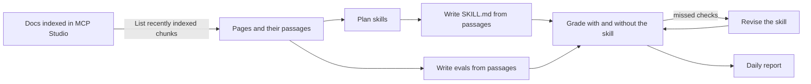

# docs-to-self-evaluating-skills

Turn documentation you trust into agent skills your AI coding assistant can follow, and have each skill graded against that documentation and improved every day.

Say you are adding Amazon S3 uploads to a web app. Index the S3 docs in [MCP Studio](https://appatools.com/mcp-studio), point this project at that source, and you get skills such as `s3-presigned-uploads`: a `SKILL.md` that Cursor, Claude Code, or Codex follows to set it up in your codebase, built from the exact passages in the docs. Each skill ships with evals written from the same passages, a score with and without the skill, and a daily report of what improved.

It is a sample project for the MCP Studio API. Everything it reads comes from one endpoint, [List recently indexed chunks](https://docs.appatools.com/api/reference/sources), and its grading is the same evidence-checked grading as the MCP Studio eval playground.

## How it works



Every day, after MCP Studio refreshes your sources:

1. **Sync.** Reads every chunk of each configured source and compares page fingerprints with yesterday's. A source that is still indexing is skipped until tomorrow.
2. **Plan.** On the first run, a model reads the page titles and proposes up to six task-shaped skills, each tied to the pages it needs. The plan is saved in `state/plan.json`; edit it by hand if you like.
3. **Build.** A new skill, or one whose pages changed, is written from those pages' passages. Its evals are rewritten from the same passages, so the skill is graded against the docs rather than against itself.
4. **Grade.** Each eval is answered twice, once following the skill and once without it, and every check is graded. A pass counts only when the grader quotes the answer, so a lenient grader cannot pass a check it did not verify.
5. **Improve.** The model revises the skill using the checks it missed, and the revision is graded again. It replaces the skill only if it passes at least two more checks **and** no fewer held-out checks. Half the evals are held out and never shown to the reviser, so a skill cannot be rewritten to pass only the tests it saw.
6. **Report.** Writes `reports/YYYY-MM-DD.md`: what changed in each source, every skill's score with and without it, the change since yesterday, the checks a revision fixed, and pages no skill covers yet.

## Quickstart

You need Node 20 or later, an MCP Studio account, and an OpenAI API key.

1. **Index your docs.** In [MCP Studio](https://appatools.com/mcp-studio), create a server and add the documentation as a source. Wait until the source shows as indexed.
2. **Create an API key** in [**Account** > **API Keys**](https://appatools.com/mcp-studio/account/api-keys). It starts with `msk_live_`.
3. **Find the source ID.**

   ```bash
   curl https://appatools.com/mcp-studio/api/mcp/<your-server-slug> \
     -H "Authorization: Bearer $MCP_STUDIO_API_KEY" | jq '.sources[] | {id, url}'
   ```

4. **Configure.** Put the server slug and source ID in `skills.config.json`, and copy `.env.example` to `.env` with your keys.
5. **Run.**

   ```bash
   npm test
   npm run daily
   ```

   The first run plans and builds the skills. Expect about five minutes and about 200 model calls for six skills, fewer on later days.

## Run it every day on GitHub Actions

`.github/workflows/daily.yml` runs at 15:00 UTC, two hours after MCP Studio refreshes sources, and commits `skills/`, `state/`, and `reports/` back to the repository. The run summary on the Actions page is that day's report.

1. Push this repository to GitHub.
2. Add `MCP_STUDIO_API_KEY` and `OPENAI_API_KEY` under **Settings** > **Secrets and variables** > **Actions**. Optionally add a variable named `OPENAI_MODEL`.
3. Run the workflow once from the **Actions** tab, or wait for the schedule. Tick **replan** to plan the skills again from scratch.

## Use the skills

Each skill is a folder in `skills/` containing `SKILL.md`. Copy the folders you want into your assistant's skills directory, such as `.cursor/skills/` or `.claude/skills/`, in the project where you are building. The `## Sources` list at the bottom of each skill links the pages it was written from.

`skills/<name>/evals/evals.json` holds the evals and the score without the skill. `skills/<name>/evals/latest.json` holds the latest answers and grades, if you want to see why a check failed.

## Configuration

`skills.config.json`:

| Field | Default | Meaning |
|---|---|---|
| `sources` | | `[{ "server": "<slug or id>", "sourceId": "<id>" }]` |
| `maxSkillsPerSource` | 6 | Skills planned per source |
| `evalsPerSkill` | 4 | Evals per skill, half held out |
| `improveRounds` | 2 | Revision attempts per skill per day |
| `minGain` | 2 | Extra checks a revision must pass to be kept |
| `maxPassageChars` | 40000 | Documentation text given to the model per skill |

Environment: `MCP_STUDIO_API_KEY`, `OPENAI_API_KEY`, `OPENAI_MODEL` (default `gpt-4o-mini`), and `MCP_STUDIO_BASE_URL` if you are not using `https://appatools.com/mcp-studio`.

## Example

`examples/mcp-studio-sdk-docs/` is two consecutive days run against the MCP Studio SDK docs with two skills: the skills, their evals, and both reports. It was run before `minGain` was raised to 2, so its second day kept a one-check revision that the current default would not.

On the first day the Codex skill passed 8 of 12 checks against 1 of 12 without it, and the Claude skill passed 11 of 12 against 0.

## What the score means, and what it does not

- The score is the share of checks, written from the documentation, that an answer following the skill passes. The baseline is the same model answering without the skill.
- Answers are graded as text. Nothing is executed, so a passing answer has the right steps and identifiers, not necessarily code that runs.
- One graded run per day varies by a check or two even when nothing changed. Read a small move as noise; that is why `minGain` defaults to 2.
- When a skill's pages change, the skill and its evals are rewritten from the new text, so earlier revisions to that skill are replaced.
- Very large sources show only the first 400 page titles to the planner. Split the source, or edit `state/plan.json`, if the skills you want are beyond that.

## Files

```
skills.config.json      which sources to read, and limits
src/mcp-studio.mjs      the chunks endpoint client
src/pages.mjs           pages, fingerprints, and what changed
src/plan.mjs            planning skills from page titles
src/skills.mjs          writing and revising SKILL.md
src/evals.mjs           writing, running, and scoring evals
src/eval-core.mjs       evidence-checked grading from the eval playground
src/daily.mjs           the daily run
src/report.mjs          the daily report
skills/ state/ reports/ output, committed by the daily workflow
```

## License

MIT
